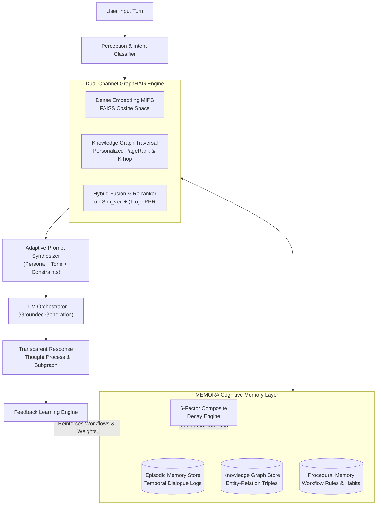

# MEMORA AI — System Architecture & Cognitive Theory
### A Human-Centered AI System with Long-Term Memory, GraphRAG, and Adaptive Personalization

> **Target Collaboration**: Microsoft Research (MSR) — Cognitive AI & Next-Generation Retrieval Systems  
> **Author**: Trishna K.

---

## 1. System Overview & Cognitive Psychology Grounding

Modern Large Language Models (LLMs) operate as stateless inference engines: context beyond the immediate context window is discarded, user-specific relational evolution is lost, and answers default to generic statistical modes.

**MEMORA AI** bridges the gap between static LLM reasoning and human cognitive architecture by introducing a unified **Tripartite Memory Hierarchy** coupled with **Dual-Channel GraphRAG** and a continuous **6-Factor Memory Decay & Consolidation System**.

---

## 2. The Tripartite Memory Architecture

MEMORA implements human cognitive memory inspired by Tulving's multiple-memory systems theory:

### 2.1. Episodic Memory
- **Definition**: Temporally indexed records of conversational interactions, events, user intent shifts, and situational contexts.
- **Attributes**: `(id, session_id, timestamp, user_query, assistant_response, salience_score, access_count, decay_score, embedding)`.
- **Purpose**: Enables the agent to maintain conversational continuity across days, weeks, and sessions without losing prior decisions.

### 2.2. Semantic Memory (Knowledge Graph Triples)
- **Definition**: Structured, verifiable factual knowledge representing entities, relationships, attributes, and domain concepts.
- **Formulation**: Directed labeled graph $\mathcal{G} = (\mathcal{V}, \mathcal{E}, \mathcal{R})$, where:
  - $\mathcal{V}$ are entity nodes (Types: `Concept`, `Person`, `Process`, `Tool`, `Event`, `Organization`, `Preference`).
  - $\mathcal{E}$ are relational edges $(u, v, r, w)$ with predicate $r \in \mathcal{R}$ and edge weight $w \in \mathbb{R}^+$.
- **Purpose**: Prevents semantic drift and hallucination by grounding entities in explicit graph topology.

### 2.3. Procedural Memory
- **Definition**: Implicit rules, formatting standards, code execution guidelines, and communication habits that govern *how* tasks are accomplished.
- **Dynamic Adaptation**: Updated automatically through user reinforcement and critique (e.g., preference for KaTeX derivations, PyTorch typing annotations, or concise synthesis).

---

## 3. The 6-Factor Composite Memory Decay & Consolidation Engine

To avoid both catastrophic forgetting (dropping critical core knowledge) and unbounded context pollution (hoarding transient chatter), MEMORA implements a **6-Factor Composite Retention Scoring Function**:

$$Score_{retention}(m_i) = \sum_{k=1}^{6} w_k \cdot F_k(m_i), \quad \text{subject to } \sum_{k=1}^{6} w_k = 1.0$$

### Mathematical Specification of the Six Factors:

| Factor | Cognitive Basis | Mathematical Formulation | Weight ($w_k$) |
| :--- | :--- | :--- | :--- |
| **1. Recency ($F_R$)** | Ebbinghaus Forgetting Curve | $F_R(\Delta t) = \exp\left(-\lambda \cdot \frac{\Delta t}{\tau}\right)$ | $0.25$ |
| **2. Frequency ($F_F$)** | Hebbian Practice Saturation | $F_F(a) = \frac{\ln(1 + a)}{\ln(1 + a) + \kappa_f}$ | $0.20$ |
| **3. Salience ($F_S$)** | Emotional/Semantic Weight | $F_S \in [0.0, 1.0]$ assigned at encoding | $0.20$ |
| **4. User Verification ($F_V$)** | Human Confirmation Boost | $F_V = \min(1.0, V_{base} + 0.1 \cdot N_{reinforce})$ | $0.15$ |
| **5. Graph Centrality ($F_C$)** | Topological Hub Permanence | $F_C(v_i) = \frac{\ln(1 + \text{deg}(v_i))}{\ln(1 + \text{deg}_{max})}$ | $0.10$ |
| **6. Procedural Utility ($F_U$)** | Workflow Actionability | $F_U = 0.95$ if procedural else $0.45$ | $0.10$ |

### Memory Consolidation Lifecycle:
- **$Score \ge 0.82$**: Promoted to **Consolidated Core Memory** (highly resilient to decay).
- **$0.25 \le Score < 0.82$**: **Active Working/Intermediate Memory**.
- **$Score < 0.25$**: **Decaying State** (flagged for review or soft archiving).
- **$Score < 0.12$**: Eligible for automatic consolidation pruning.

---

## 4. Dual-Channel GraphRAG Engine

Standard Vector RAG projects chunks into $\mathbb{R}^d$ and retrieves the nearest neighbors via Maximum Inner Product Search (MIPS). While effective for surface lexical matches, vector-only retrieval fails on **multi-hop relational queries** and collapses under semantic collision.

### Hybrid Fusion Algorithm
1. **Vector Channel**: Encodes query $q$ into vector $\mathbf{v}_q$ and performs FAISS cosine lookup over episodic and semantic chunks:
   $$\text{Sim}_{vec}(q, c_i) = \frac{\mathbf{v}_q \cdot \mathbf{v}_{c_i}}{\|\mathbf{v}_q\| \|\mathbf{v}_{c_i}\|}$$
2. **Graph Traversal Channel**: Identifies seed entities $\mathcal{V}_{seeds} \subseteq \mathcal{V}$ present in top vector hits and query tokens. Traverses $k$-hop relational neighborhoods and computes Personalized PageRank (PPR):
   $$\mathbf{p} = (1 - d) \mathbf{s} + d \mathbf{P}^T \mathbf{p}$$
   where $\mathbf{s}$ is the personalized restart vector on seed nodes.
3. **Re-Ranking Fusion**:
   $$\mathcal{S}_{hybrid}(q, n_i) = \alpha \cdot \text{Sim}_{vec}(q, n_i) + (1 - \alpha) \cdot \left[ \mathbf{p}(n_i) \cdot Score_{retention}(n_i) \right]$$

---

## 5. Adaptive Personalization & Feedback Learning Loop

1. **Dynamic Prompt Synthesis**: Modulates persona, tone depth (`academic_rigorous`, `concise`, `technical_code`, `pedagogical`), and constraints based on the active user profile.
2. **Online Preference Learning**: When feedback (thumbs up/down, critique, star rating) is submitted:
   - Reinforces active procedural rules.
   - Adjusts emotional salience and decay parameters.
   - Updates user profile tone if implicit style preferences are detected.
